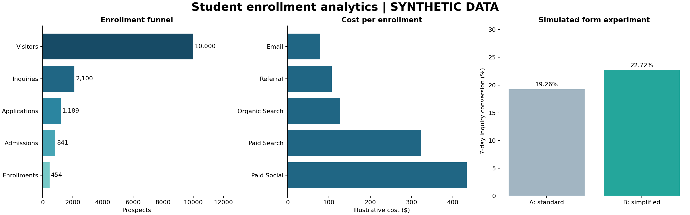

# Student Enrollment Funnel & A/B Testing

**Independent portfolio case study · synthetic data · simulated experiment**

**Status:** SQL/Python analysis, reproducible data, notebook, report, and Tableau-ready exports complete. **Native Tableau workbook and public dashboard: not yet created.**

A fictional online university wants to understand marketing channel costs, enrollment drop-off, and whether a simplified inquiry form changes conversion. This project answers those questions using 10,000 synthetic prospects, SQL, a randomized experiment simulation, and logistic regression.



## Computed results

| Measure | Result |
| --- | --- |
| Prospects / inquiries / enrollments | 10,000 / 2,100 / 454 |
| Visitor-to-enrollment conversion | 4.54% |
| Illustrative acquisition cost | $94,760.04 |
| Cost per enrollment | $208.72 |
| Form A inquiry conversion | 959 / 4,979 = 19.26% |
| Form B inquiry conversion | 1,141 / 5,021 = 22.72% |
| B minus A | +3.46 percentage points; 17.98% relative lift |
| 95% difference interval | +1.87 to +5.06 percentage points |
| Two-sided p-value | 0.0000212 |
| Allocation mismatch p-value | 0.6745 |
| Held-out regression ROC AUC | 0.631 |
| Held-out average precision / prevalence | 0.079 / 0.046 |

The form effect is intentionally encoded in the synthetic generator. These are computed simulation results, **not measured business impact**. Channel rankings follow assumed budgets and behavior. The model is a baseline with limited discrimination.

## Explore

- [Executed analysis notebook](analysis.ipynb)
- [Business brief: findings, methods, and limitations](results/business_brief.md)
- [Static HTML report](results/report.html) — download this folder and open locally; GitHub shows HTML source.
- [SQL queries](analysis.sql)
- [Python pipeline](run_analysis.py)
- [Tableau exports](tableau/)
- [Tableau dashboard instructions](TABLEAU_GUIDE.md)
- [Data dictionary and generation assumptions](DATA_DICTIONARY.md)
- [Exact metrics](results/metrics.json) and [validation checks](results/validation.json)

## Reproduce

Python 3.11+ is required; this run used Python 3.12.14. From a clone of this repository:

```bash
cd projects/student-enrollment-funnel
python -m venv .venv
# macOS/Linux:
source .venv/bin/activate
# Windows PowerShell instead: .venv\Scripts\Activate.ps1
python -m pip install -r requirements.txt
python run_analysis.py
python -m unittest -v test_analysis.py
```

The fixed seed is `20261028`. The command regenerates raw CSVs, a local SQLite database, Tableau-ready summaries, exact metrics, charts, and the business report. No credentials, paid services, or external data downloads are needed. Dependency versions are pinned to the tested environment. The notebook reads the same source pipeline, and its stored outputs come from executing its cells. Opening it in Jupyter requires a Jupyter environment, which is optional for the command-line workflow.

Compressed raw data are included under `data/`: decompress `prospects.csv.gz` and `campaign_costs.csv.gz` to open as CSV, or regenerate them. The SQLite database and uncompressed raw CSVs are generated locally and not committed.

## Analytical choices

- **Funnel:** first visit → inquiry → application → admission → enrollment. One record per prospect, nested outcomes, ordered dates.
- **Cohorts:** January–June 2025 acquisition; complete 90-day follow-up through September 28. This is cohort conversion, not calendar-month enrollment reporting.
- **Attribution:** first-touch channel. Costs are aggregated to month × channel before joining, avoiding duplicated spend. Organic/owned-channel costs include illustrative labor/content budgets.
- **Experiment:** persistent 50/50 prospect assignment; fixed 10,000-person sample; inquiry within seven days is the only primary outcome. Two-sided pooled z test; Wilson rate bounds; Newcombe interval for the rate difference. Allocation checks and descriptive balance are included. Planning assumptions and methods are declared in code before generation; this is not an externally preregistered trial.
- **Regression:** L2-regularized logistic regression on pre-outcome channel/device/program/variant features, 75/25 stratified holdout, no hyperparameter search. Compare ROC AUC, average precision, Brier score, and log loss with an intercept-only baseline. Coefficients are descriptive regularized associations.
- **Validation:** six automated tests cover reproducibility, data integrity, rejection of invalid records, join inflation/zero denominators, and agreement of the z test with an independent chi-square test.

## Tableau delivery boundary

CSV files and a complete dashboard specification are ready. No native Tableau workbook has been authored or tested, and no Tableau Public link is claimed. The included images and HTML report were generated with Python. After building and verifying the workbook in Tableau, add its actual publication link here.

## Portfolio description

“Built a reproducible SQL/Python case study analyzing 10,000 synthetic enrollment prospects, evaluated a simulated randomized form experiment with confidence intervals, and prepared Tableau-ready funnel and channel-cost exports.”

Use a Tableau-dashboard claim only after the workbook is actually built. This project was developed with AI assistance; the repository includes the executable implementation and transparent assumptions for review.

## Primary references

- [SciPy: binomial test and Wilson proportion interval](https://docs.scipy.org/doc/scipy/reference/generated/scipy.stats.binomtest.html)
- [Tableau: CSV/text file connections](https://help.tableau.com/current/pro/desktop/en-us/examples_text.htm)
- [Tableau Public FAQ](https://help.tableau.com/current/pro/desktop/en-us/public_faq.htm)
